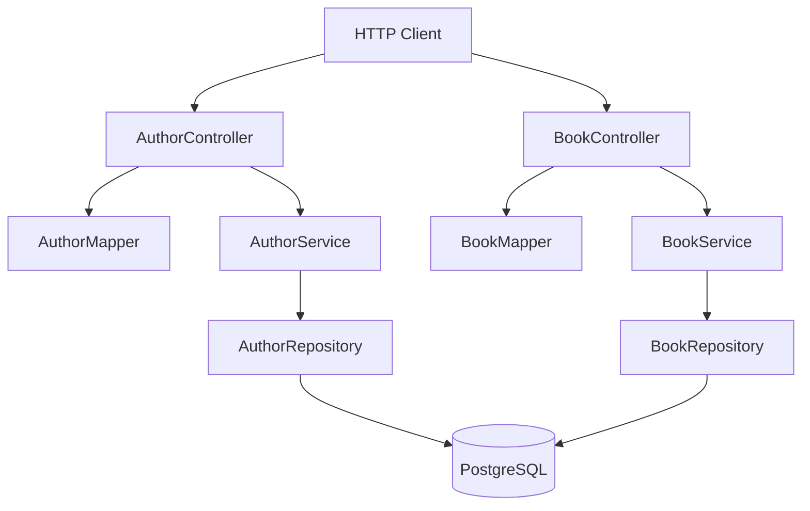
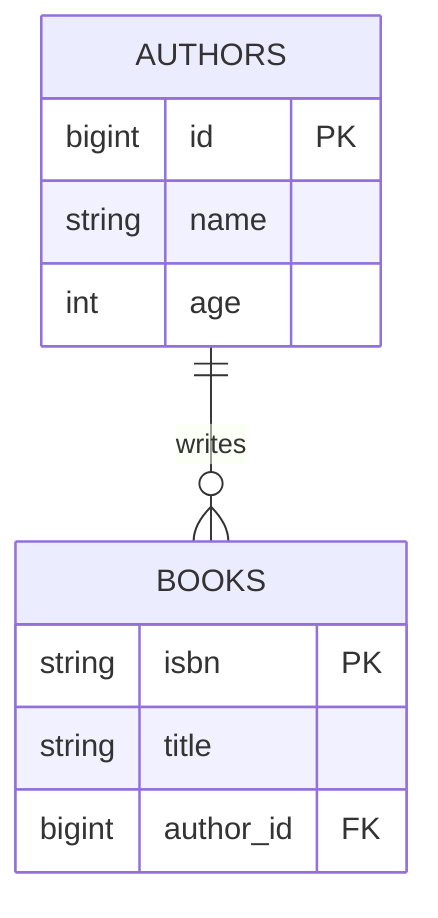

# BookShelf

BookShelf is a small REST API I built to learn Spring Boot. It keeps track of authors and books, saves them in a PostgreSQL database with Spring Data JPA, and lets you create, read, update, and delete both through HTTP endpoints.

It's the project where I learned Spring Boot, and I used what I learned here directly when building Structura afterwards.

Want to try it? Jump to [Local PostgreSQL Setup](#local-postgresql-setup).

---

## Project Goals

I made BookShelf for one reason: to learn Spring Boot. I wanted to understand how a REST API is put together, how a database gets added to it, and how all the pieces fit. Spring Boot is widely used for big company software, so I also wanted to see, even at a small scale, how that kind of project is structured.

Here's what I set out to do:

1. Describe my data with JPA entities.
2. Save those entities through Spring Data repositories.
3. Keep database classes separate from the classes the API sends and receives (DTOs).
4. Put the business logic behind service interfaces.
5. Turn HTTP requests into service calls with controllers.
6. Check that the repositories and endpoints work with integration tests.

---

## Features

- REST endpoints for authors and books
- Full create, read, update, and delete for authors
- Create-or-update for books with `PUT /books/{isbn}`
- Partial updates with `PATCH`
- Pagination on the book list endpoint
- PostgreSQL storage for normal runs
- An in-memory H2 database for integration tests
- DTO and entity separation using ModelMapper
- A JPA relationship between books and authors
- Repository queries: derived queries, plus a custom JPQL query for author ages
- Spring Boot Actuator as a dependency, for operational endpoints
- Docker configuration for packaging the app

---

## Architecture

BookShelf follows the usual controller-service-repository layout. Here's how the pieces connect:



And here's the path a request takes:

```text
Request JSON -> Controller -> Service -> Repository -> PostgreSQL
                    |            |
                    v            v
              DTO mapping   update rules
```

- **Controllers** are the front door. They accept JSON, call the services, turn entities into DTOs, and pick the main response status codes.
- **Services** hold the app's operations, like checking whether something exists and applying partial updates.
- **Repositories** are Spring Data interfaces. Spring writes their implementations, including the standard create, read, update, and delete queries, when the app starts.

Two terms you'll see a lot: an **entity** is a Java class that maps to a database table, and a **DTO** (data transfer object) is the shape of the data the API sends and receives.

---

## Domain Model

There are two resources: authors and books.

### Author

Authors are stored in the `authors` table:

| Field | Java type | What it is |
|-------|-----------|------------|
| `id` | `Long` | Generated primary key |
| `name` | `String` | Author name |
| `age` | `Integer` | Author age |

`AuthorEntity` is the JPA entity mapped to `authors`, and its ID is generated from a sequence. `AuthorDto` has the same three fields for now, but I keep it separate from the database class so the API can change without touching the database model.

### Book

Books are stored in the `books` table:

| Field | Java type | What it is |
|-------|-----------|------------|
| `isbn` | `String` | Primary key, also used in the URL |
| `title` | `String` | Book title |
| `author` | `AuthorEntity` | Many-to-one relationship |

`BookEntity` uses `isbn` as its primary key and joins to authors through the `author_id` column. The relationship goes from book to author only. `AuthorEntity` doesn't have a list of its books.



The relationship uses `CascadeType.ALL`, so saving a book can also save its author. That's handy, but deletes and other operations can spread further than you'd expect, so it needs care in a real application.

---

## DTO Mapping

The API uses DTOs so the controllers never expose JPA entities directly:

- `AuthorDto` is the author data the API sends and receives.
- `BookDto` is the book data, with an `AuthorDto` inside it.
- `Mapper<A, B>` defines two operations, `mapTo` and `mapFrom`.
- `AuthorMapper` and `BookMapper` implement it using ModelMapper.

`MapperConfig` registers one shared ModelMapper and uses the `LOOSE` matching strategy. That lets it map compatible fields between DTOs and entities, including the nested author inside a book.

---

## API Reference

The app runs on port `8080` by default, or on whatever you set in the `PORT` environment variable.

### Authors

#### `POST /authors`

Creates an author. The database generates the ID.

```json
{
  "name": "Abigail Rose",
  "age": 80
}
```

Returns `201 Created` with the saved author, including its new ID:

```json
{
  "id": 1,
  "name": "Abigail Rose",
  "age": 80
}
```

#### `GET /authors`

Returns all authors as a JSON array, with `200 OK`.

#### `GET /authors/{id}`

Returns one author by numeric ID: `200 OK` if it's found, `404 Not Found` if not.

#### `PUT /authors/{id}`

Replaces an existing author completely. The ID in the path is assigned to the request before saving, so the path always wins.

```json
{
  "name": "Thomas Cronin",
  "age": 44
}
```

Returns `200 OK` if the author exists, `404 Not Found` if not.

#### `PATCH /authors/{id}`

Updates only some of an existing author's fields. Only the fields you send (the non-null ones) are copied onto the stored author.

```json
{
  "name": "Updated Name"
}
```

Returns `200 OK` with the updated author, or `404 Not Found` if the ID doesn't exist.

#### `DELETE /authors/{id}`

Deletes the author and returns `204 No Content`. The controller currently returns the same status even if the ID doesn't exist.

### Books

#### `PUT /books/{isbn}`

Creates the book if the ISBN is new, or replaces it if the ISBN already exists:

- `201 Created` when a new ISBN is added
- `200 OK` when an existing ISBN is updated

The ISBN in the URL is assigned to the entity before saving, so the URL wins over the request body.

```json
{
  "isbn": "978-1-2345-6789-0",
  "title": "The Shadow in the Attic",
  "author": {
    "name": "Abigail Rose",
    "age": 80
  }
}
```

The response contains the saved ISBN, title, and nested author. When a new author is saved along with the book, the database generates its ID.

#### `GET /books`

Returns a page of books. Spring fills in the `Pageable` argument from the query parameters:

```text
GET /books?page=0&size=10
GET /books?page=1&size=5&sort=title,asc
```

The response is Spring's `Page` format: a `content` list plus pagination details like `number`, `size`, `totalElements`, and `totalPages`.

#### `GET /books/{isbn}`

Returns one book by ISBN with `200 OK`, or `404 Not Found` if there's no match.

#### `PATCH /books/{isbn}`

Partially updates an existing book. For now, the service only updates the title, and only when you send one. The ISBN comes from the URL, and the nested author isn't touched by this method.

Returns `200 OK` with the updated book, or `404 Not Found` if the ISBN doesn't exist.

#### `DELETE /books/{isbn}`

Deletes the book with that ISBN and returns `204 No Content`. A missing ISBN gets the same response.

---

## Repository Queries

`AuthorRepository` shows two ways to write a query:

```java
Iterable<AuthorEntity> findByAgeLessThan(int age);
```

Here, Spring Data builds the query from the method name.

```java
@Query("SELECT a from AuthorEntity a where a.age > ?1")
Iterable<AuthorEntity> findAuthorsWithAgeGreaterThan(int age);
```

This one is JPQL, not raw SQL. It refers to the entity class and its Java fields instead of database tables and columns. Both methods are covered by repository integration tests, but I haven't exposed them through an HTTP endpoint.

---

## Technology Stack

| Layer | Technology |
|-------|------------|
| Language | Java 21 |
| Framework | Spring Boot 3.3.3 |
| HTTP | Spring Web / Spring MVC |
| Persistence | Spring Data JPA / Hibernate |
| Production database | PostgreSQL 16 |
| Test database | H2 in PostgreSQL compatibility mode |
| Object mapping | ModelMapper 3.2.6 |
| Boilerplate reduction | Lombok |
| Observability dependency | Spring Boot Actuator |
| Build tool | Maven |
| Containerization | Docker |
| Testing | JUnit 5, Spring Boot Test, MockMvc, AssertJ |

---

## Configuration

The app reads its PostgreSQL settings from environment variables:

| Variable | What it's for |
|----------|---------------|
| `SPRING_DATASOURCE_URL` | JDBC connection URL |
| `SPRING_DATASOURCE_USERNAME` | Database username |
| `SPRING_DATASOURCE_PASSWORD` | Database password |
| `PORT` | HTTP port, `8080` by default |

The normal configuration uses the PostgreSQL driver and this setting:

```properties
spring.jpa.hibernate.ddl-auto=update
```

`ddl-auto=update` lets Hibernate update the database schema from the entity classes, which is handy while developing. For production, schema migrations with Flyway or Liquibase are safer and repeatable.

The app sets the JVM's default timezone to `Asia/Kolkata` at startup. There are no date or time fields in the domain model yet, but this could affect future date values and logs.

---

## Local PostgreSQL Setup

The included `docker-compose.yml` starts PostgreSQL 16:

```bash
docker compose up -d db
```

The database runs on port `5432` with these development settings:

| Setting | Value |
|---------|-------|
| Host | `localhost` |
| Port | `5432` |
| Username | `postgres` |
| Password | `changemeinprod!` |
| Database | `postgres` |

Set matching datasource values before running the app:

```bash
export SPRING_DATASOURCE_URL=jdbc:postgresql://localhost:5432/postgres
export SPRING_DATASOURCE_USERNAME=postgres
export SPRING_DATASOURCE_PASSWORD='changemeinprod!'
```

Then start the API:

```bash
mvn spring-boot:run
```

The API will be available at `http://localhost:8080`.

---

## Docker Build

The `Dockerfile` uses a two-stage build:

1. A Maven and Eclipse Temurin 21 image compiles the project and builds the JAR.
2. An Eclipse Temurin 21 Alpine image runs that JAR.

To build and run the container:

```bash
docker build -t springboot-crud-api .
docker run --rm \
  -p 8080:8080 \
  -e SPRING_DATASOURCE_URL=jdbc:postgresql://host.docker.internal:5432/postgres \
  -e SPRING_DATASOURCE_USERNAME=postgres \
  -e SPRING_DATASOURCE_PASSWORD='changemeinprod!' \
  springboot-crud-api
```

The database hostname can be different on Linux, or when both services run in a Docker network. In that case, use the database service name and put both services on the same Compose network.

---

## Testing

My tests are integration tests. They start the whole Spring application context with `@SpringBootTest`. The controller tests use `@AutoConfigureMockMvc`, so I can send HTTP requests without starting a separate web server.

The tests use an in-memory H2 database in PostgreSQL compatibility mode:

```properties
jdbc:h2:mem:testdb;MODE=PostgreSQL;DATABASE_TO_LOWER=TRUE;DEFAULT_NULL_ORDERING=HIGH
```

They cover creating, retrieving, and listing authors, full and partial updates, deletion, saving books, the book and author relationship, pagination, repository updates and deletes, and both author age queries.

Run them with:

```bash
mvn test
```

Once the Maven wrapper is fully set up in the repository, this works too:

```bash
./mvnw test
```

---

## Project Structure

```text
.
├── src/main/java/com/example/PostgreSQLDataBaseConnect
│   ├── PostgreSqlDataBaseConnectApplication.java  # Application entry point
│   ├── config/                                    # Spring configuration
│   ├── controllers/                               # REST endpoints
│   ├── domain/
│   │   ├── dto/                                   # API request/response models
│   │   └── entities/                              # JPA persistence models
│   ├── mappers/                                   # DTO/entity mapping contracts
│   ├── respositories/                             # Spring Data repositories
│   └── services/                                  # Service contracts and logic
├── src/main/resources/application.properties      # PostgreSQL configuration
├── src/test/java/                                 # Repository and controller tests
├── src/test/resources/application.properties      # H2 test configuration
├── docker-compose.yml                             # PostgreSQL development service
├── Dockerfile                                     # Container build
├── pom.xml                                        # Maven dependencies and plugins
└── README.md                                      # Project documentation
```

---

## Design Decisions

### Why use DTOs?

DTOs put a boundary between what the API sends and receives and how the data is stored. I can change the database model without automatically changing the JSON, and the controllers don't depend on JPA classes.

### Why use services?

The service layer is a home for the update rules and the existence checks. For example, partial updates deliberately skip null fields, while full updates replace the author data you send.

### Why use `PUT` for creating and replacing books?

An ISBN is a stable identifier, so `PUT /books/{isbn}` can be idempotent: sending the same data to the same ISBN should leave you with the same stored book. The API tells you what happened with `201` (inserted) versus `200` (updated).

### Why paginate books but not authors?

Books use Spring Data's pageable repository method, so the whole collection doesn't have to load into one response as the dataset grows. Authors just use a simple `findAll()` and return everyone.

---

## Current Limitations And Production Considerations

BookShelf is a learning project, so it's missing a few things a production API would need. Here's what I know about:

- There's no request validation, such as `@Valid`, `@NotBlank`, `@Positive`, or ISBN checks.
- There's no central exception handler for malformed requests, database errors, or service exceptions.
- Delete operations return `204` even when the record doesn't exist.
- `BookEntity` uses `CascadeType.ALL`, which can spread deletes and other operations further than expected.
- There's no authentication, authorization, rate limiting, or CORS policy.
- `spring.jpa.hibernate.ddl-auto=update` is convenient for development, but it isn't a migration strategy.
- The Docker Compose password is for development only and shouldn't be reused in production.
- Some test names and HTTP verbs don't match what the tests actually do, so treat the implementation as the source of truth until I fix them.
- The Maven wrapper script is there, but this checkout doesn't include `.mvn/wrapper/maven-wrapper.properties`, so `./mvnw` can't download Maven by itself yet.

---

## License

There's no license file in this repository yet.
