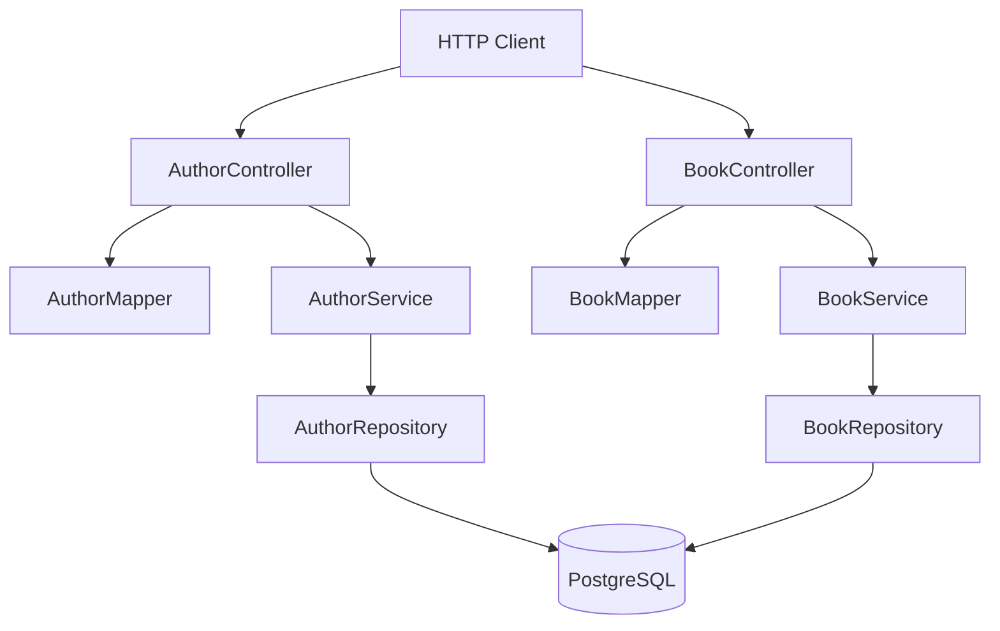

# Spring Boot CRUD REST API

This project is a learning-focused REST API built with Spring Boot. It models a small library domain containing authors and books, persists that data with Spring Data JPA, and exposes HTTP endpoints for creating, reading, updating, and deleting both resources.

The application follows a conventional layered architecture:



> **Current scope:** This repository contains a backend API only. There is no frontend, authentication layer, ML model, or external API client in the source tree. The sections below describe what is implemented and leave explicit placeholders where you can add your own explanation later.

## Features

- REST endpoints for authors and books
- Full author CRUD workflow
- Book create-or-update workflow using `PUT /books/{isbn}`
- Partial updates using HTTP `PATCH`
- Pagination for the book collection endpoint
- PostgreSQL persistence for normal application runs
- H2 in-memory database configured for integration tests
- DTO/entity separation using ModelMapper
- JPA relationship between books and authors
- Repository-level derived queries and a custom JPQL query for author ages
- Spring Boot Actuator dependency for operational endpoints
- Docker image configuration for packaging the application

## Project Goals

This repository appears to be a practical exercise in building a CRUD service with Spring Boot. The learning path is:

1. Define a domain model with JPA entities.
2. Persist entities through Spring Data repositories.
3. Keep database-facing entities separate from API-facing DTOs.
4. Put business operations behind service interfaces.
5. Translate HTTP requests into service calls through controllers.
6. Verify repository and HTTP behavior with integration tests.

### Add your project context here

Use this section to describe why you created the project, what you were learning, and what you would like a reader to understand after exploring it.

## Architecture

The application follows a controller-service-repository flow:

```text
Request JSON -> Controller -> Service -> Repository -> PostgreSQL
				 |             |
				 v             v
			  DTO mapping   update rules
```

Controllers are the HTTP boundary. They accept JSON, call service interfaces, map entities to DTOs, and choose the main response status codes. Services contain the application operations such as existence checks and partial updates. Repositories are Spring Data interfaces whose implementations and standard CRUD queries are generated at runtime.

## Domain Model

The application has two resources: authors and books.

### Author

An author is stored in the `authors` table:

| Field | Java type | Role |
|-------|-----------|------|
| `id` | `Long` | Generated primary key |
| `name` | `String` | Author name |
| `age` | `Integer` | Author age |

`AuthorEntity` is a JPA entity mapped to `authors`. Its ID uses a sequence-generation strategy. `AuthorDto` currently has the same three fields, but remains separate from the database class so the API contract can evolve independently.

### Book

A book is stored in the `books` table:

| Field | Java type | Role |
|-------|-----------|------|
| `isbn` | `String` | Primary key and URL identifier |
| `title` | `String` | Book title |
| `author` | `AuthorEntity` | Many-to-one relationship |

`BookEntity` uses `isbn` as its primary key and joins to authors through the `author_id` column. The Java model defines the relationship from book to author; `AuthorEntity` does not currently contain a collection of books.

```text
authors.id  <---- books.author_id
	1                 many
```

The relationship uses `CascadeType.ALL`, so saving a book can also persist its associated author. Deletion and other lifecycle operations should therefore be considered carefully in a production application.

## DTO Mapping

The API uses DTOs so controllers do not expose JPA entities directly:

- `AuthorDto` represents author data at the API boundary.
- `BookDto` represents book data and contains an embedded `AuthorDto`.
- `Mapper<A, B>` defines `mapTo` and `mapFrom` operations.
- `AuthorMapper` and `BookMapper` implement that interface with ModelMapper.

`MapperConfig` registers a shared ModelMapper bean and uses the `LOOSE` matching strategy. This maps compatible fields between DTOs and entities, including the nested author structure in a book.

## API Reference

The application listens on port `8080` by default, or on the value supplied by the `PORT` environment variable.

### Authors

#### `POST /authors`

Creates an author. The database generates the ID.

```json
{
	"name": "Abigail Rose",
	"age": 80
}
```

Returns `201 Created` with the saved author, including its generated ID:

```json
{
	"id": 1,
	"name": "Abigail Rose",
	"age": 80
}
```

#### `GET /authors`

Returns all authors as a JSON array with `200 OK`.

#### `GET /authors/{id}`

Returns one author by numeric ID. It returns `200 OK` when found and `404 Not Found` otherwise.

#### `PUT /authors/{id}`

Performs a full replacement of an existing author. The path ID is assigned to the request before saving, so the path is authoritative.

```json
{
	"name": "Thomas Cronin",
	"age": 44
}
```

It returns `200 OK` when the author exists and `404 Not Found` otherwise.

#### `PATCH /authors/{id}`

Partially updates an existing author. Only non-null request fields are copied onto the stored author.

```json
{
	"name": "Updated Name"
}
```

It returns `200 OK` with the updated author or `404 Not Found` when the ID is missing.

#### `DELETE /authors/{id}`

Deletes the author and returns `204 No Content`. The current controller returns the same status even when the ID does not exist.

### Books

#### `PUT /books/{isbn}`

Creates a book when the ISBN does not exist, or replaces the book when it does:

- `201 Created` when a new ISBN is inserted
- `200 OK` when an existing ISBN is updated

The ISBN in the URL is assigned to the entity before saving, making the path ISBN authoritative over the request body.

```json
{
	"isbn": "978-1-2345-6789-0",
	"title": "The Shadow in the Attic",
	"author": {
		"name": "Abigail Rose",
		"age": 80
	}
}
```

The response contains the saved ISBN, title, and nested author. The author ID is generated when a new author is persisted.

#### `GET /books`

Returns a paginated collection of books. Spring injects the `Pageable` argument from query parameters:

```text
GET /books?page=0&size=10
GET /books?page=1&size=5&sort=title,asc
```

The response is a Spring `Page` representation containing `content` and pagination metadata such as `number`, `size`, `totalElements`, and `totalPages`.

#### `GET /books/{isbn}`

Returns one book by ISBN with `200 OK`, or `404 Not Found` when no matching book exists.

#### `PATCH /books/{isbn}`

Partially updates an existing book. The current service updates the title when a non-null title is supplied. The ISBN is retained from the URL, and the nested author is not selectively updated by this method.

It returns `200 OK` with the updated book or `404 Not Found` when the ISBN is missing.

#### `DELETE /books/{isbn}`

Deletes the book identified by ISBN and returns `204 No Content`. Missing ISBNs receive the same response.

## Repository Queries

`AuthorRepository` demonstrates two query styles:

```java
Iterable<AuthorEntity> findByAgeLessThan(int age);
```

Spring Data derives the query from the method name.

```java
@Query("SELECT a from AuthorEntity a where a.age > ?1")
Iterable<AuthorEntity> findAuthorsWithAgeGreaterThan(int age);
```

This is JPQL, not raw SQL. It refers to the entity class and Java field rather than directly naming database tables and columns. These methods are covered by repository integration tests but are not currently exposed through an HTTP endpoint.

## Technology Stack

| Layer | Technology |
|-------|------------|
| Language | Java 21 |
| Framework | Spring Boot 3.3.3 |
| HTTP | Spring Web / Spring MVC |
| Persistence | Spring Data JPA / Hibernate |
| Production database | PostgreSQL 16 |
| Test database | H2 in PostgreSQL compatibility mode |
| Object mapping | ModelMapper 3.2.6 |
| Boilerplate reduction | Lombok |
| Observability dependency | Spring Boot Actuator |
| Build tool | Maven |
| Containerization | Docker |
| Testing | JUnit 5, Spring Boot Test, MockMvc, AssertJ |

## Configuration

The application reads PostgreSQL connection settings from environment variables:

| Variable | Purpose |
|----------|---------|
| `SPRING_DATASOURCE_URL` | JDBC connection URL |
| `SPRING_DATASOURCE_USERNAME` | Database username |
| `SPRING_DATASOURCE_PASSWORD` | Database password |
| `PORT` | HTTP port, defaulting to `8080` |

The normal configuration uses the PostgreSQL driver and:

```properties
spring.jpa.hibernate.ddl-auto=update
```

`ddl-auto=update` allows Hibernate to update the schema from the entity model during development. For production, schema migrations with Flyway or Liquibase are generally safer and reproducible.

The application sets the JVM default timezone to `Asia/Kolkata` at startup. There are currently no date/time fields in the domain model, but this setting may affect future temporal values and logs.

## Local PostgreSQL Setup

The included `docker-compose.yml` starts PostgreSQL 16:

```bash
docker compose up -d db
```

The database is published on port `5432` with these development settings:

| Setting | Value |
|---------|-------|
| Host | `localhost` |
| Port | `5432` |
| Username | `postgres` |
| Password | `changemeinprod!` |
| Database | `postgres` |

Export matching datasource values before running the application:

```bash
export SPRING_DATASOURCE_URL=jdbc:postgresql://localhost:5432/postgres
export SPRING_DATASOURCE_USERNAME=postgres
export SPRING_DATASOURCE_PASSWORD='changemeinprod!'
```

Then start the API:

```bash
mvn spring-boot:run
```

The API should be available at `http://localhost:8080`.

> The Compose file currently starts the database only. The application is run separately through Maven or the Dockerfile.

## Docker Build

The `Dockerfile` uses a two-stage build:

1. A Maven and Eclipse Temurin 21 builder image compiles the project and creates the JAR.
2. An Eclipse Temurin 21 Alpine runtime image runs that JAR.

Build and run the application container:

```bash
docker build -t springboot-crud-api .
docker run --rm \
	-p 8080:8080 \
	-e SPRING_DATASOURCE_URL=jdbc:postgresql://host.docker.internal:5432/postgres \
	-e SPRING_DATASOURCE_USERNAME=postgres \
	-e SPRING_DATASOURCE_PASSWORD='changemeinprod!' \
	springboot-crud-api
```

The database hostname may differ on Linux or when both services run in a Docker network. In that case, use the database service name and place both services on the same Compose network.

## Testing

The tests are integration-oriented and start the Spring application context with `@SpringBootTest`. Controller tests use `@AutoConfigureMockMvc`, so HTTP requests can be exercised without starting an external web server.

The test configuration uses an in-memory H2 database in PostgreSQL compatibility mode:

```properties
jdbc:h2:mem:testdb;MODE=PostgreSQL;DATABASE_TO_LOWER=TRUE;DEFAULT_NULL_ORDERING=HIGH
```

The suite covers author creation, retrieval, listing, full and partial updates, deletion, book persistence, book/author relationships, pagination wiring, repository updates and deletes, and both author age query styles.

Run it with:

```bash
mvn test
```

If the Maven wrapper is completed in the repository, the equivalent command is:

```bash
./mvnw test
```

## Project Structure

```text
.
├── src/main/java/com/example/PostgreSQLDataBaseConnect
│   ├── PostgreSqlDataBaseConnectApplication.java  # Application entry point
│   ├── config/                                    # Spring configuration
│   ├── controllers/                               # REST endpoints
│   ├── domain/
│   │   ├── dto/                                   # API request/response models
│   │   └── entities/                              # JPA persistence models
│   ├── mappers/                                   # DTO/entity mapping contracts
│   ├── respositories/                             # Spring Data repositories
│   └── services/                                  # Service contracts and logic
├── src/main/resources/application.properties      # PostgreSQL configuration
├── src/test/java/                                 # Repository and controller tests
├── src/test/resources/application.properties      # H2 test configuration
├── docker-compose.yml                             # PostgreSQL development service
├── Dockerfile                                     # Container build
├── pom.xml                                        # Maven dependencies and plugins
└── README.md                                      # Project documentation
```

> The package is named `respositories` in the current codebase. The conventional spelling is `repositories`; changing it would require updating package declarations and imports throughout the project.

## Design Decisions

### Why use DTOs?

DTOs create a boundary between the HTTP contract and the database model. Persistence details can change without automatically changing the JSON API, and controllers remain independent of JPA classes.

### Why use services?

The service layer gives the application a home for update rules and existence checks. For example, partial updates intentionally ignore null fields, while full updates replace the supplied author data.

### Why use `PUT` for book creation and replacement?

The ISBN is a stable identifier, so `PUT /books/{isbn}` can be idempotent: sending the same representation to the same ISBN should produce the same stored book. The implementation communicates whether data was inserted or updated through `201` versus `200`.

### Why paginate books but not authors?

Books use Spring Data's pageable repository method, which avoids loading the entire book collection into one response as the dataset grows. Authors currently use a simple `findAll()` flow and return every author.

## Current Limitations And Production Considerations

- There is no request validation such as `@Valid`, `@NotBlank`, `@Positive`, or ISBN validation.
- There is no centralized exception handler for malformed requests, database errors, or service exceptions.
- Delete operations return `204` even when the requested record does not exist.
- `BookEntity` uses `CascadeType.ALL`, which may propagate deletes or other operations farther than expected.
- The API has no authentication, authorization, rate limiting, or CORS policy configured.
- `spring.jpa.hibernate.ddl-auto=update` is convenient for development but is not a migration strategy.
- The Docker Compose password is a development credential and must not be reused in production.
- Some endpoint test names and HTTP verbs do not match their intent; the implementation should be treated as the source of truth until those tests are corrected.
- The Maven wrapper script is present, but this checkout does not include `.mvn/wrapper/maven-wrapper.properties`, so `./mvnw` cannot currently bootstrap Maven by itself.

## Database And API Diagram Placeholder

Add an ER diagram, request-flow image, or screenshots here when you have them. A useful diagram should show:

- `authors` and `books` tables;
- the `books.author_id` foreign key;
- the ISBN primary key;
- the controller-to-service-to-repository request path;
- the distinction between DTOs and entities.

## ML Model Details Placeholder

This repository does not currently contain an ML model or an inference pipeline. If machine-learning functionality is planned for this project, document it here using the same structure as your previous project:

### Model purpose

Describe the problem the model solves, its inputs, outputs, and how it fits into this REST API.

### Dataset

Add the dataset source, number of records, fields, labels, preprocessing, and train/validation/test split.

### Model architecture

Add the algorithm or architecture, important layers or components, input/output shape, and the reason this approach was selected.

### Training configuration

Add the optimizer, learning rate, loss function, batch size, number of epochs, hardware, and checkpoint strategy.

### Evaluation and results

Add accuracy or task-specific metrics, baselines, confusion-matrix observations, and examples of successful and unsuccessful predictions.

### Deployment and inference flow

Explain where the model is loaded, how requests are preprocessed, how inference is triggered, and what response contract the API returns.

### Model limitations

Document out-of-distribution behavior, confidence limitations, data bias, performance trade-offs, and cases where users should not trust a prediction.

## Learning Notes Placeholder

Use this section for the concepts you learned while building the project. Possible topics include:

- dependency injection through constructor parameters;
- how Spring Data derives queries from method names;
- how JPQL differs from SQL;
- how `Pageable` and `Page<T>` work;
- why entities and DTOs should be separate;
- how JPA cascade behavior affects related records;
- how H2 compatibility mode helps test PostgreSQL-oriented code.

## Future Improvements

Potential next steps include:

- add Bean Validation and meaningful validation error responses;
- add a global `@ControllerAdvice` exception handler;
- add author and book search endpoints;
- add pagination to authors;
- add sorting and filtering documentation;
- replace automatic schema updates with Flyway or Liquibase migrations;
- add API documentation with OpenAPI/Swagger;
- add unit tests for services and mappers;
- add Testcontainers-based PostgreSQL integration tests;
- add authentication and authorization;
- complete a combined Docker Compose setup for the API and database.

## License

No license file is currently present in the repository. Add the license information here when one is selected.